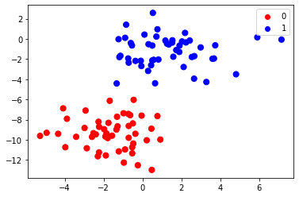
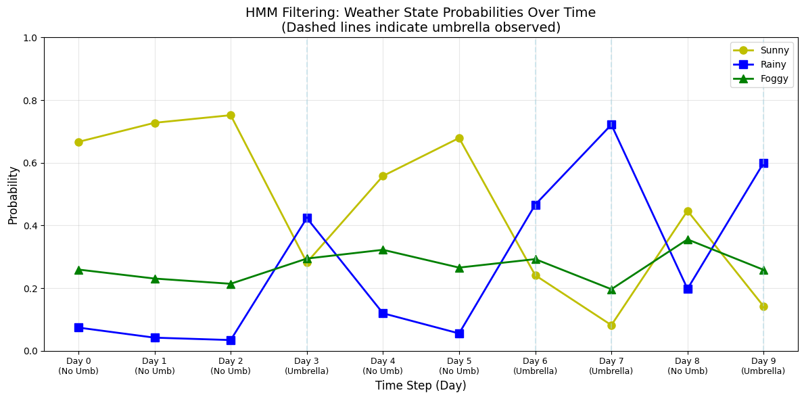
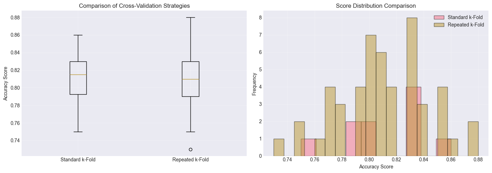

# NLP with NLTK — Shakespeare's Hamlet and Genre Classification

Six modules of natural language processing with Python's NLTK, ending in a full pipeline on Shakespeare's *Hamlet*: tokenize the play, clean the text, compare stemming and lemmatization, and then classify document genres with Naive Bayes.

From Northeastern's EAI6000 course (instructor Mitch Harris, CRN 21414, Winter 2026). Module 1 essay completed 11 January 2026.

## In plain language

This course builds NLP step by step. It starts with essays and search, then Bayes' rule, then hidden Markov models, then how to measure a model honestly with repeated cross-validation — and finishes with the real thing: taking *Hamlet*, all 37,360 words of it, and teaching a computer to tell news writing from fiction.

The final module's headline result is 100% accuracy on genre classification — but on a validation set of only 15 documents, so this README flags that plainly instead of presenting it as a triumph.

## Module 1 — Multi-Agent Systems (essay)

An essay comparing multi-agent systems in healthcare, rescue and mining: MADIP, TeleCARE/BASN, and the FirstLook rescue robot, with the 2021 Florida condo collapse and the 1942 Benxihu Colliery disaster (1,549 killed) as case studies.

## Module 2 — A* Search

A walkthrough of A* search on a 7×7 maze — plus an impossible maze, to show what happens when no path exists. No accuracy numbers; this module is about understanding the algorithm.

## Module 3 — Naive Bayes

Bayes' rule and Naive Bayes, worked through on three datasets:

- A synthetic make_blobs toy: accuracy 1.0 on train, 0.825 on test.
- **20 Newsgroups, 4 categories: train/test accuracy 0.9206.**
- An iris GaussianNB exercise.

## Module 4 — Hidden Markov Model: the weather and the umbrella

A weather model built with the HMM forward algorithm. Priors: sunny 0.5, rainy 0.25, foggy 0.25, over 10 days of umbrella / no-umbrella observations.

- Day 0, no umbrella → sunny **0.6667**.
- Day 7, umbrella → rainy **0.7216**.

The point of the exercise: the same observation means different things depending on what came before it, and the forward algorithm is how you work that out day by day.

## Module 5 — Repeated K-Fold Cross-Validation (two runs)

Two notebooks run the same experiment with different random seeds — both are staged, because they are not duplicates and their results differ.

- **Assignment notebook (random_state=1):** synthetic data, 1,000 samples, 20 features (15 informative, 5 redundant). 10-fold logistic regression accuracy **0.868 ± 0.032**; repeated k-fold **0.867 ± 0.031**. Repeating the folds 1–13 times, the standard error falls from 0.0106 to 0.0028 — the lesson of the module is that repeating folds is what makes the estimate stable.
- **kFold notebook (random_state=42):** mean accuracy **0.8110**, repeated **0.8098** (min 0.73, max 0.88). Model comparison on the same data: logistic regression 0.8098, decision tree 0.7954, Random Forest 0.9134, KNN 0.9218, **SVM 0.9402**, Gradient Boosting 0.8980.

## Module 6 — NLP: Hamlet and genre classification

The final module, in two notebook versions that run the same pipeline (they differ only in comments; both are staged).

**Hamlet, by the numbers:** the play as loaded from NLTK's Gutenberg corpus — **37,360 words, 3,106 sentences, 162,881 characters.** Preprocessing: tokenization, lowercasing, stopword removal with a combined 635-word list, Porter stemming versus WordNet lemmatization with part-of-speech tags. The most common stemmed words in the first 10,000 characters: mar 17, hor 14, 'd 14, speake 14, haue 13, king 12 — Shakespeare's spelling, stemmed.

**Genre classification:** Brown Corpus documents, news vs fiction — 73 documents (44 news, 29 fiction), train 58 / validation 15, vocabulary 11,371, Bag-of-Words via CountVectorizer with a custom `preprocess_text`, Multinomial Naive Bayes. **Accuracy 100.00% on the 15-document validation set** (fiction 5/5, news 10/10). The final model retrained on all 73 documents has vocabulary 13,177 and predicts 4/4 custom test sentences correctly.

**The honest flag:** 15 documents is a very small validation set. 100% on 15 documents means the pipeline works and the classes are separable here — it does not mean the model would score 100% on new writing. The README says so because the number alone would mislead.

## Datasets — a note

There are no dataset files in this repo, because there are none on disk in the course folder. Every corpus downloads at runtime through NLTK: Gutenberg, punkt, punkt_tab, stopwords, wordnet, averaged_perceptron_tagger, brown. Run a notebook once and NLTK fetches what it needs.

## What is in this repo

- `module-1-multi-agent-systems-essay/` — the Module 1 essay (docx).
- `module-2-a-star-search/` — A* search notebook.
- `module-3-naive-bayes/` — Naive Bayes notebook.
- `module-4-hidden-markov-weather-model/` — HMM weather notebook.
- `module-5-repeated-k-fold-cross-validation/` — both k-fold notebooks (different seeds, different results).
- `module-6-nlp-hamlet-genre-classification/` — both Hamlet/genre notebooks (same pipeline, different comments).
- `images/` — 13 real charts extracted from the notebook outputs: 7 from Module 3, 1 from Module 4, 5 from Module 5.

## How to use it

1. Install NLTK and let the notebooks download their corpora on first run (`nltk.download('gutenberg')`, `'punkt'`, `'stopwords'`, `'wordnet'`, `'averaged_perceptron_tagger'`, `'brown'`).
2. Start with Module 6 for the headline project, or work through Modules 1–5 in order to see how the pieces build up.
3. Read the Module 5 notebooks side by side to see how much results move with the random seed — that is the point of repeated cross-validation.

## Tools

Python, NLTK (Gutenberg, Brown Corpus, punkt, stopwords, wordnet, averaged_perceptron_tagger), scikit-learn (Naive Bayes, logistic regression, SVM, Random Forest, KNN, Gradient Boosting), matplotlib.

## What was left out, and why

- Duplicate copies of the Module 2 and Module 3 notebooks (`eai6000_m02_hw_completed.ipynb`, `eai6000_m03_hw_completed.ipynb`) — the Dev-named versions are the fuller canonical ones; not double-uploaded.
- A blank Module 4 template (`eai6000_m04_hw-1.ipynb`, 19 cells of "YOUR CODE HERE") — the completed notebook is staged instead.

## Conclusion

The course moves from "how does a search algorithm think" to "how does a computer read Shakespeare" in six modules, and the through-line is measurement: Bayes on 20 Newsgroups at 92%, the HMM tracking weather day by day, repeated cross-validation showing that one accuracy number is never the whole story, and a genre classifier that is perfect on 15 documents — which is exactly why the size of the test set belongs next to the score, every time.
